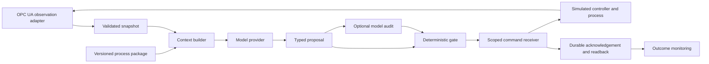

# Local OT assurance bench — V2

**Workshop entry:** [Quick start](QUICKSTART.md) · [Offline training](TRAINING.md) · [Recorded results](docs/TYPED_QWEN_EXPERIMENT.md)

A standalone local integration bench: capture measurements, ask a model for a bounded proposal, check it independently, obtain a controller acknowledgement, and observe the delayed process response.

**Open:** http://127.0.0.1:18790 once the services below are running.

This repository is separate from `water-ot-ai-lab`. It has no V1 imports, shared database, Cloudflare deployment or physical command adapter. Water and cooling use compact first-order equations built for integration testing. They are not the full V1 simulators.

## Start

Requires Docker Compose, Python 3.12+, and optionally a local Ollama service for real inference.

```sh
python3 scripts/preflight.py --init
docker compose up -d --build
```

The initializer creates a private `.env` with random V2 database and receiver credentials. It does not copy existing credentials. Ports are loopback-only: web **18790**, OPC UA **18840**. The database and command receiver have no published host ports.

For local scripts and tests:

```sh
python3 -m venv .venv
.venv/bin/pip install -e '.[test]'
.venv/bin/pytest -q
```

Default model: Ollama `qwen3:4b`. Optional auditor: `gemma3:4b`. These are the configured local models, not an automatically selected fine-tuned adapter. Existing weights are neither downloaded nor modified by this project. If Ollama is unavailable, the record says inference failed. The separately labelled **fixture** is a deterministic transport-test policy, never a model fallback.

The latest [model review](docs/MODEL_REVIEW.md) found that clearer context improves structured responses but does not yet make either tested Qwen size reliable across the local cases. The audit model and active policy are visible in the controls; new audit requests and responses are retained in evidence exports.

The offline [typed Qwen adaptation experiment](docs/TYPED_QWEN_EXPERIMENT.md) records the frozen protocol, actual local results and readiness limits. It does not change the active provider.

## First walkthrough

1. Open the local page, choose **New bench session** and click **Load exercise**.
2. Choose `fixture` for a reproducible plumbing test, or `qwen` for a real model trial.
3. Select audit mode: **off**, **observe**, or **required**, then arm control.
4. Enable application and run one analysis. Inspect proposed target, gate result, controller acknowledgement and readback separately.
5. Watch the measured response. Acceptance changes a target immediately; the measured value responds over time.
6. Start feedback for repeated analysis after the observation window, up to 12 calls. Closing the tab does not stop the server loop. **Stop** disarms control.

For reproducible commands, fault tests and switching to cooling, see [RUNBOOK](docs/RUNBOOK.md).

## How reuse works



The reusable core owns context, checks, supervision, records and timing. The package supplies units, relationships, SOP context and bounded capabilities. The transport supplies acquisition and command acknowledgement. Water and cooling currently share one simple process family; more complex manufacturing requires a new process implementation and qualification, not just renaming tags.

Read [MODULES](docs/MODULES.md), [PROVENANCE](docs/PROVENANCE.md) and [VERIFICATION](docs/VERIFICATION.md) before interpreting results or extending the bench.

## Stop

```sh
docker compose down
```

This preserves the V2 PostgreSQL volume and records. Do not add `--volumes` unless you intend to erase that local evidence. No automatic rearm occurs after a restart.

The [live scenario test](docs/SCENARIO_TESTING.md) covers 24 water/cooling decision responses, timed monitoring and a critical alarm during feedback. One cooling response was recovered after host sleep without a verified post-state. The report separates model/audit failures from successful process and protection checks.

The [decision and audit improvement review](docs/MODEL_IMPROVEMENTS_V2.md) records subsequent context, typed-target and gate changes, model replays, live recovery checks and remaining reviewer limitations. These are local system improvements, not new weight training.
